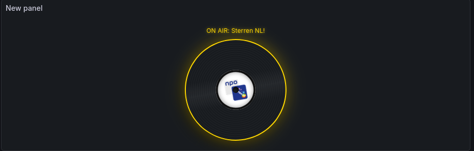
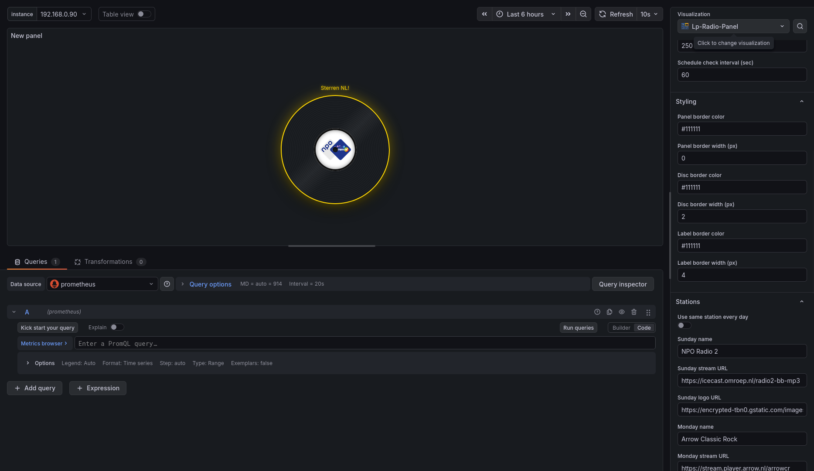

# LP Radio Panel

Interactive vinyl-style radio panel for Grafana. The panel supports weekday-based station scheduling, optional timed override, and now playing metadata per station.

## Screenshots




## Features

- Clickable vinyl disk UI that plays a configured radio stream.
- Day-by-day station setup or one shared station for all days.
- Optional station presets with per-day preset selection.
- Timed override for selected weekdays between a start and end hour.
- Now playing presets for NPO Sterren NL, Arrow Classic Rock, and custom JSON APIs.
- Optional continuous playback mode for dashboard playlist transitions.
- Styling controls for panel, disk, and label borders.
- Grafana variable support in station name, stream URL, and logo URL.

## Station presets

You can optionally use presets as a faster way to configure day schedules.

1. Enable `Use station presets for days` in panel options.
2. Configure preset slots in the `Presets` category.
3. Select a preset per day in the `Stations` category.
4. Choose `No preset` for a day to use that day's custom station fields.

This is additive and non-breaking: existing day-by-day station setup continues to work.

## Dashboard playlists

The radio only has to be on one dashboard of a playlist. With `Continue playback in playlists` enabled it keeps playing on dashboards without a radio panel.

1. Put the radio panel on the first dashboard of the playlist. Grafana reloads the page after every third playlist loop, and playback resumes as soon as a radio panel is loaded again.
2. Click the disc once. Browsers block audio until a visitor interacts with the page, and may block the resume after a reload too. In that case the panel shows the `Start hint text`. On an unattended screen, start Chrome with `--autoplay-policy=no-user-gesture-required`.
3. While the radio plays on a dashboard without a radio panel, a small stop button is shown. Disable `Show stop button without panel` to hide it on unattended screens.

Stream recovery keeps working on dashboards without a radio panel. The station schedule is only applied while a radio panel is on screen.

## Now Playing and CORS

This panel runs in the browser as a Grafana panel plugin and cannot use Grafana's server-side data source proxy for arbitrary HTTP requests.
Some external now-playing APIs block browser-origin requests due to CORS policy.

The Arrow Classic Rock preset uses `r.jina.ai` as a default CORS-friendly wrapper so metadata can be fetched in browser context.

You can set one global CORS proxy for all stations with the panel option `Now playing CORS proxy URL`.
- Leave empty to use the preset default behavior.
- Use a URL prefix (for example `https://r.jina.ai/`) to prepend the API URL.
- Or use `{{url}}` placeholder when your proxy expects a query parameter (for example `https://my-proxy.example/fetch?url={{url}}`).

When a now-playing request is blocked by CORS (or another network-level browser restriction), the panel stops polling that endpoint for the active station and falls back to normal station/status text.
To keep now-playing metadata enabled, use endpoints that allow browser CORS or place a CORS-enabled proxy in front of the metadata API.

By default metadata is only fetched while the panel is playing. Disable `Only fetch now playing while playing` to also show it on a stopped panel.

## Add your own now-playing API

Yes. You can configure your own endpoint without code changes:

1. Set the station `now playing preset` to `Custom JSON API`.
2. Fill in `now playing API URL` with your endpoint.
3. Optionally set `Now playing CORS proxy URL` when the endpoint blocks browser CORS.

The custom parser tries common keys such as `artist`, `title`, `song`, `track`, `image`, and `coverUrl`.

## Requirements

- Grafana `>=12.3.0`
- Node.js `>=22` (for local development)

## Getting started

```bash
npm install
npm run dev
```

Run a local Grafana instance with provisioning:

```bash
npm run server
```

## Build and package

Create a production build:

```bash
npm run build
```

Create a distributable ZIP package:

```bash
npm run package:zip
```

## Validation

```bash
npm run typecheck
npm run lint
npm run test:ci
```

## Signing and publishing

For community publication, first submit the plugin for review via Grafana Plugins Admin. After approval, sign a release build with:

```bash
export GRAFANA_ACCESS_POLICY_TOKEN=<your_token>
npx @grafana/sign-plugin@latest
```

## Support

- Repository: https://github.com/finnie2006/teuwsenservices-lpradio-panel
- Issues: https://github.com/finnie2006/teuwsenservices-lpradio-panel/issues
